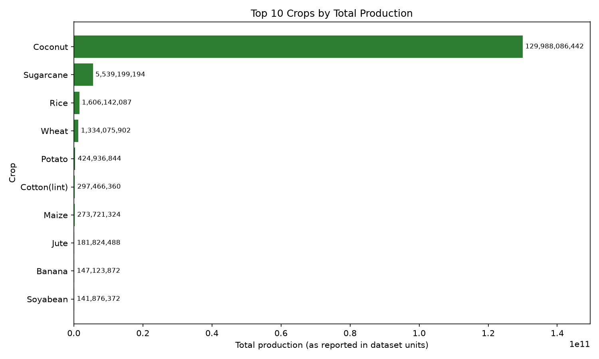

# Crop Production Analysis (India)

A Python project that analyzes Indian crop production data using the **KDD (Knowledge Discovery in Databases)** approach: load the data, clean it, mine it, visualize it, and interpret the patterns.

---

## 1. Introduction

Agriculture is central to India's economy and food security. Analyzing crop production data helps identify which crops, states, seasons and years drive agricultural output, and supports better planning for farming, storage, pricing and policy.

## 2. Objective

To analyze crop production using government agricultural data and answer:

- Which crops contribute the most to total production?
- How concentrated is production among the top crops?
- Which state, season and year lead in production?

## 3. Dataset

| Item | Details |
|---|---|
| Original source | Ministry of Agriculture & Farmers Welfare, Govt. of India (district-wise, season-wise crop production statistics, published on [data.gov.in](https://data.gov.in)) |
| File used | `crop_production.csv` (a copy of the dataset covering 1997 to 2015) |
| Size | 246,091 rows, 7 columns |

**Columns**

| Column | Description |
|---|---|
| `State_Name` | State or union territory |
| `District_Name` | District |
| `Crop_Year` | Year of production |
| `Season` | Kharif, Rabi, Whole Year, etc. |
| `Crop` | Crop name |
| `Area` | Cultivated area |
| `Production` | Quantity produced |

## 4. Methodology (KDD stages)

| Stage | What the script does |
|---|---|
| **Selection** | Loads the CSV, standardizes column names, checks that the required columns exist |
| **Preprocessing** | Trims whitespace in text columns, converts `Production` to numeric, fills missing production with the median of the same crop, drops rows that remain empty, and removes negative values and duplicates |
| **Transformation** | Aggregates the data by crop |
| **Data mining** | Groups and compares crops by total production, average production, record count and % share |
| **Visualization** | Bar chart of the top 10 crops |
| **Interpretation** | Prints the patterns found (top crop, top state, season and year) |

### Handling missing values

3,730 rows had a missing `Production` value. These were filled with the **median production of the same crop**. The median was used instead of the mean because production values are heavily skewed. No other columns had missing values, and no duplicates were found.

## 5. Project structure

```
Python-project/
├── crop_analysis.py     # Main script
├── crop_production.csv  # Dataset
├── top10_crops.png      # Output chart (generated)
├── README.md            # This file
└── venv/                # Virtual environment (not committed)
```

## 6. Setup and usage (macOS / Linux)

**Requirements:** Python 3.9+, `pandas`, `matplotlib`

```bash
cd Python-project

# Create and activate a virtual environment
python3 -m venv venv
source venv/bin/activate

# Install dependencies
pip install pandas matplotlib

# Run the analysis
python crop_analysis.py --csv crop_production.csv
```

**Optional arguments**

| Argument | Default | Description |
|---|---|---|
| `--csv` | (required) | Path to the dataset |
| `--top` | `10` | Number of top crops to show |
| `--out` | `top10_crops.png` | Output chart filename |

Example:

```bash
python crop_analysis.py --csv crop_production.csv --top 5 --out top5.png
```

> Note: On macOS, use `python3` outside the virtual environment. After `source venv/bin/activate`, `python` works. Re-run the `source` command each time you open a new terminal.

On Windows, activate the environment with `venv\Scripts\activate` instead.

## 7. Results

**Top 10 crops by total production**

| Rank | Crop | Share of total |
|---|---|---|
| 1 | Coconut | 92.07% |
| 2 | Sugarcane | 3.92% |
| 3 | Rice | 1.14% |
| 4 | Wheat | 0.94% |
| 5 | Potato | 0.30% |
| 6 | Cotton (lint) | 0.21% |
| 7 | Maize | 0.19% |
| 8 | Jute | 0.13% |
| 9 | Banana | 0.10% |
| 10 | Soyabean | 0.10% |



**Other findings**

- 124 distinct crops were analyzed.
- The top 10 crops account for **99.1%** of all recorded production.
- Top state by production: **Kerala**
- Top season by production: **Whole Year**
- Top year by production: **2011**

## 8. Conclusion

- Production is **extremely concentrated**: a small number of crops make up almost all of the recorded total.
- **Coconut** appears dominant, followed by **sugarcane**, then the staple grains **rice** and **wheat**.
- **Kerala** leads by state, which is consistent with coconut being its major crop. This is also why **Whole Year** (perennial crops such as coconut and sugarcane) leads by season.
- Rice and wheat have the highest number of records, meaning they are grown across the widest range of districts, even though their total tonnage is lower than coconut and sugarcane.

## 9. Limitations

- **Mixed units:** The dataset reports different crops in different units. Coconut, for example, is recorded in **number of nuts**, not tonnes, so it is not directly comparable with crops measured by weight. This inflates coconut's share. For a fairer comparison, exclude coconut or compare crops measured in the same unit.
- **Imputation:** Filling missing production with the crop median is an assumption and may under- or over-state production in specific districts.
- **Time range:** The data covers 1997 to 2015 and does not reflect recent years.
- **Totals vs. area:** The analysis ranks crops by total production only. It does not normalize by cultivated area (yield).

## 10. Possible improvements

- Compare crops by **yield** (production per unit area).
- Add state-wise and year-wise trend charts.
- Exclude or separately handle crops with non-weight units.
- Build an interactive dashboard (for example with Streamlit).

## 11. Data source and credits

Data originates from the Ministry of Agriculture & Farmers Welfare, Government of India, through the Open Government Data (OGD) Platform India (data.gov.in).
